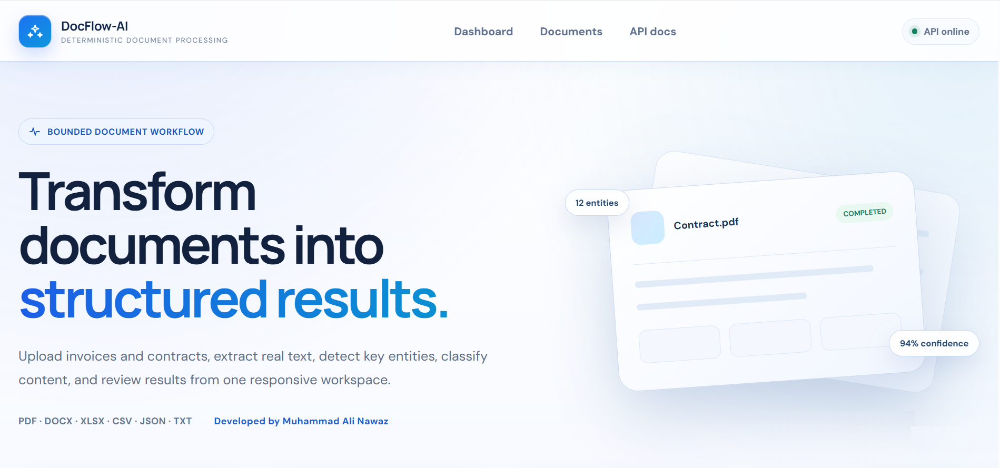

<div align="center">

# 📄 DocFlow-AI — Deterministic Document Processing Platform

A FastAPI + Vue platform for securely uploading business documents, extracting bounded content, applying explainable rule-based analysis, tracking jobs, and reviewing structured results.


</div>

---

## 📌 Project Overview

**DocFlow-AI** is a deterministic document-processing platform designed to convert common business documents into structured, reviewable results.

The application combines a **FastAPI backend**, **Vue 3 dashboard**, **async SQLAlchemy persistence**, **SQLite or PostgreSQL**, bounded parsers for seven file formats, and transparent rule-based classification and field extraction.

Users can upload documents, monitor processing states, retry failed or interrupted jobs, inspect extracted metadata and domain fields, view aggregate metrics, and download the confined original source.

DocFlow-AI does not use an LLM or machine-learning model. The name is project branding; processing is deterministic and rule based.

---

## ✨ Features

### 📄 Document Workspace

- 📤 **Document upload and processing** through the Vue dashboard or REST API
- ✅ **Validation** for extension, MIME type, signature, empty files, and configured size limits
- 📚 **Supported formats**: PDF, DOCX, XLSX, CSV, JSON, Markdown, and UTF-8 text
- 🔄 **Explicit processing states**: `uploaded → queued → processing → completed/failed`
- ♻️ **Deterministic failed-job retry** without uploading the validated source again
- 📋 **Document listing, status tracking, and aggregate metrics**
- 📥 **Confined source-document download**
- 🧹 **Upload cleanup** when validation or database persistence fails

### 🧠 Deterministic Document Intelligence

- 📖 **Bounded content extraction** across supported file formats
- 🧾 **Invoice detection and fields** such as invoice number, totals, tax, and due date
- 📑 **Contract detection and clause analysis**
- 🏷️ **Keyword frequency and entity extraction**
- 📝 **Structured summaries and document metadata**
- 🎯 **Explainable weighted classification signals and confidence**
- ❓ **Unknown fallback** when evidence does not support invoice or contract classification
- 🔒 **No external AI provider, API model, or model key required**

### 🛡️ Reliability and Security Controls

- 🔐 **Explicit local and fail-closed hosted modes**
- 🔑 **Operator-entered hosted access key** retained only in browser `sessionStorage`
- 🚫 **No permanent server secret compiled into Vite or public JavaScript**
- ⏱️ **Startup recovery** that marks interrupted queued/processing jobs failed and retryable
- ⚛️ **Atomic job claiming** to prevent duplicate processing
- 🚦 **Bounded upload, extraction, archive, worksheet, row, cell, and page limits**
- 🧨 **Office ZIP-bomb protection** using expanded-size and compression-ratio checks
- 🧾 **Request IDs, sanitized public errors, and internal exception logging**
- 📁 **Storage-root confinement** for downloads
- 🌐 **Explicit CORS and trusted-host configuration**
- 🗄️ **Alembic migrations** for hosted PostgreSQL
- 👤 **Non-root backend container**

### 🖥️ Vue Interface

- 📊 Dashboard metrics for total, active, completed, and failed documents
- 📥 Upload panel with progress feedback
- 📋 Responsive document table and structured result drawer
- 🔁 Manual processing and retry controls
- 🔐 Hosted access-key dialog and forget-session-key control
- 📱 Responsive light-mode portfolio interface
- 👨‍💻 Developer attribution for Muhammad Ali Nawaz 2026

---

## 🖼️ Screenshots

| DocFlow-AI |
| --- |
|  |

---

## 🧰 Tech Stack

### Frontend

- Vue 3.5
- Vite 8
- Native Fetch API and XMLHttpRequest upload progress
- Responsive custom CSS
- Nginx production frontend

### Backend

- Python 3.11+
- FastAPI 0.116
- Uvicorn
- Pydantic Settings
- SQLAlchemy 2 AsyncIO
- aiosqlite, asyncpg, and Alembic
- python-multipart

### Document Processing

- pypdf
- python-docx
- openpyxl
- Python CSV, JSON, ZIP, hashing, and text-processing libraries
- Deterministic classification and field-extraction rules

### Storage and Deployment

- SQLite for local development and tests
- PostgreSQL 16 for hosted deployment
- Local or Docker-managed document storage
- Docker, Docker Compose, and Nginx

### Quality Assurance

- pytest and pytest-asyncio
- HTTPX
- Vitest
- Ruff
- Python syntax compilation
- GitHub Actions CI

---

## 📁 Folder Structure

```text
docflow-ai/
├── .github/workflows/ci.yml
├── app/
│   ├── routes/document_routes.py
│   ├── services/
│   │   ├── document_processor.py
│   │   └── job_recovery.py
│   ├── config.py
│   ├── database.py
│   ├── extended_models.py
│   ├── middleware.py
│   ├── models.py
│   ├── production_main.py
│   ├── schemas.py
│   └── security.py
├── frontend/
│   ├── src/
│   │   ├── components/
│   │   ├── services/
│   │   ├── utils/
│   │   ├── App.vue
│   │   └── main.js
│   ├── tests/
│   ├── Dockerfile
│   ├── nginx.conf
│   └── package.json
├── migrations/versions/
├── storage/uploads/
├── tests/
├── .env.example
├── .env.production.example
├── alembic.ini
├── docker-compose.production.yml
├── docker-compose.yml
├── Dockerfile.production
├── LICENSE
└── README.md
```

The application creates its SQLite database and upload folders locally. `Dockerfile.production` is used for both the local container workflow and the hosted stack. Databases, uploaded files, secrets, environments, caches, dependencies, and generated frontend output are excluded from Git.

---

## 🔐 Environment Variables

Never commit a real `.env` file or publish credentials. Copy an example file to `.env` and keep only placeholders in documentation.

### Recommended Local Configuration

```env
APP_NAME=DocFlow-AI
APP_ENV=development
APP_HOST=127.0.0.1
APP_PORT=8000
DEPLOYMENT_MODE=local

DATABASE_URL=sqlite+aiosqlite:///./app.db
CORS_ALLOW_ORIGINS=http://localhost:5173,http://127.0.0.1:5173
TRUSTED_HOSTS=localhost,127.0.0.1,testserver
LOG_LEVEL=INFO
REQUEST_ID_HEADER=X-Request-ID

STORAGE_DIR=storage/uploads
MAX_UPLOAD_SIZE_MB=10
MAX_EXTRACTED_TEXT_CHARS=500000
MAX_TEXT_BYTES=2000000
MAX_PDF_PAGES=100
MAX_OFFICE_UNCOMPRESSED_BYTES=50000000
MAX_OFFICE_COMPRESSION_RATIO=100
MAX_WORKSHEETS=25
MAX_ROWS=20000
MAX_CELLS=200000
ALLOWED_EXTENSIONS=.txt,.md,.csv,.json,.pdf,.docx,.xlsx
```

Local mode does not require `DOCFLOW_API_KEY`. Hosted mode requires PostgreSQL, explicit origins and hosts, and an API key containing at least 32 characters.

### Hosted Configuration

```env
POSTGRES_PASSWORD=<generate-a-long-random-database-password>
DOCFLOW_API_KEY=<generate-a-separate-random-key-of-at-least-32-characters>
```

Generate separate secrets and never reuse the database password as the application access key. The permanent key is supplied only to the API service. The hosted Vue interface asks the operator for it and retains it only in that tab's `sessionStorage`.

See [DATABASE_SETUP.md](DATABASE_SETUP.md) and [SECURITY.md](SECURITY.md) for deployment and security details.

---

## 🚀 Getting Started on Windows

### Prerequisites

Install:

- Windows 10 or Windows 11
- Python 3.11 or newer; Python 3.13 is tested in CI
- Node.js 22 LTS or a compatible release
- npm
- Docker Desktop only for the container workflow
- PostgreSQL only for a native hosted deployment

Ubuntu, WSL, Anaconda, and Miniconda are not required for the standard Windows setup.

---

## ▶️ Run the Complete Project

Use **Windows Command Prompt (CMD)** and run commands from the project root.

### 1. Create a Clean Virtual Environment

```bat
cd /d "D:\Resumes\Projects\Python\Projects\docflow-ai"

if exist ".venv" rmdir /s /q ".venv"
python --version
python -m venv .venv
call .venv\Scripts\activate.bat

where python
python --version
```

After activation, `where python` should list `.venv\Scripts\python.exe` first.

### 2. Install Backend and Development Dependencies

```bat
python -m pip install --upgrade pip setuptools wheel
python -m pip install -r requirements-dev.txt
python -m pip check
```

### 3. Create the Local Environment File

```bat
copy /Y .env.example .env
notepad .env
```

The example uses local mode and SQLite. No secret key is required for the standard local workflow.

### 4. Apply and Inspect Database Migrations

```bat
python -m alembic upgrade head
python -m alembic current
```

Expected migration:

```text
20260826_0001 (head)
```

### 5. Start the FastAPI Backend

Open the first CMD window:

```bat
cd /d "D:\Resumes\Projects\Python\Projects\docflow-ai"
call .venv\Scripts\activate.bat
python -m uvicorn app.production_main:app --host 127.0.0.1 --port 8000 --reload
```

Backend URLs:

```text
Readiness: http://127.0.0.1:8000/health/ready
About:     http://127.0.0.1:8000/about
Swagger:   http://127.0.0.1:8000/docs
OpenAPI:   http://127.0.0.1:8000/openapi.json
```

### 6. Install and Start the Vue Frontend

Open a second CMD window:

```bat
cd /d "D:\Resumes\Projects\Python\Projects\docflow-ai\frontend"
npm ci
npm run test
npm run build
npm run dev -- --host 127.0.0.1 --port 5173
```

Open `http://127.0.0.1:5173`.

### 7. Stop the Services

Press `Ctrl+C` once in each CMD window.

---

## 🧪 Test the Project

Tests use isolated SQLite storage and do not call external AI services.

### Complete Backend Quality Check

```bat
cd /d "D:\Resumes\Projects\Python\Projects\docflow-ai"
call .venv\Scripts\activate.bat

python -m pip check
python -m compileall -q app migrations tests scripts
python -m ruff check app migrations tests scripts
python -m pytest -q
```

The backend suite currently contains **25 tests**.

### Complete Frontend Quality Check

```bat
cd /d "D:\Resumes\Projects\Python\Projects\docflow-ai\frontend"

npm ci
npm run test
npm run build
```

The frontend suite currently contains **6 tests**. GitHub Actions repeats the frontend tests and production build on pushes and pull requests.

### Dependency Import Smoke Test

```bat
cd /d "D:\Resumes\Projects\Python\Projects\docflow-ai"
call .venv\Scripts\activate.bat
python -c "import fastapi, sqlalchemy, pypdf, docx, openpyxl; print('All project dependencies imported successfully')"
```

### Create a Synthetic Test Document

```bat
python -c "from pathlib import Path; Path('sample-karachi-invoice.txt').write_text('INVOICE\nInvoice Number: KHI-2026-12\nBill To: Clifton Harbour Traders\nAmount Due: PKR 35,000.00\nDue Date: 2026-09-01\n', encoding='utf-8'); print('Created sample-karachi-invoice.txt')"
```

Upload `sample-karachi-invoice.txt` through the Vue dashboard. The completed result should classify it as an invoice and extract the invoice number, amount, and due date.

---

## 📜 Available Commands

| Command | Description |
| --- | --- |
| `python -m uvicorn app.production_main:app --host 127.0.0.1 --port 8000 --reload` | Start the development API |
| `npm run dev -- --host 127.0.0.1 --port 5173` | Start Vue from `frontend` |
| `python -m alembic upgrade head` | Apply database migrations |
| `python -m alembic current` | Display the active migration |
| `python -m pytest -q` | Run backend tests |
| `python -m ruff check app migrations tests scripts` | Run Python lint checks |
| `python -m compileall -q app migrations tests scripts` | Compile-check Python source |
| `npm run test` | Run frontend tests |
| `npm run build` | Build the production frontend |
| `docker compose up --build` | Start the local SQLite API container |
| `docker compose -f docker-compose.production.yml up --build` | Start hosted stack |
| `docker compose -f docker-compose.production.yml down` | Stop hosted stack |

---

## 🔌 Main API Endpoints

| Method | Endpoint | Purpose |
| --- | --- | --- |
| `GET` | `/health/ready` | Check API and database readiness |
| `GET` | `/about` | Read project and deployment metadata |
| `POST` | `/documents/upload` | Upload and optionally queue a document |
| `GET` | `/documents/metrics/summary` | Read processing-state counts |
| `GET` | `/documents` | List recent documents |
| `GET` | `/documents/{job_id}` | Read document status and result |
| `POST` | `/documents/{job_id}/process` | Start or retry processing |
| `GET` | `/documents/{job_id}/download` | Download the confined source file |

Health and about routes remain public. Every document endpoint requires `X-DocFlow-Key` in hosted mode.

---

## 🎯 Project Flow

```text
User uploads a validated document
└── FastAPI streams the source into confined storage
    ├── Validate extension, MIME type, signature, and resource limits
    ├── Persist the document artifact and job
    └── Queue bounded in-process work
        ├── Atomically claim the job
        ├── Extract bounded text and metadata
        ├── Apply deterministic classification and field rules
        ├── Store the structured result
        └── Mark the job completed or safely failed
            └── Vue displays metrics, status, and structured output
```

---

## 🧠 Document Analysis Flow

```text
PDF / DOCX / XLSX / CSV / JSON / Markdown / Text
└── Format and signature validation
    └── Bounded content extraction
        ├── Text normalization
        ├── Summary generation
        ├── Keyword and entity extraction
        └── Weighted invoice/contract classification
            ├── Invoice field extraction
            ├── Contract clause analysis
            └── Unknown fallback
                └── Structured JSON result
```

---

## 🐳 Docker

Docker is optional. The standard Windows virtual-environment workflow does not require Ubuntu or WSL.

### Local SQLite API

```bat
copy /Y .env.example .env
notepad .env
docker compose up --build
```

The default Compose file runs only the FastAPI service in local mode with SQLite. It binds the API to localhost and persists the database and uploads in the `document_data` volume.

### Hosted Stack

```bat
copy /Y .env.production.example .env
notepad .env
docker compose -f docker-compose.production.yml config
docker compose -f docker-compose.production.yml up --build
```

Open:

```text
Frontend: http://127.0.0.1:8080
Swagger:  http://127.0.0.1:8080/api/docs
```

Enter `DOCFLOW_API_KEY` in the frontend access dialog. It is sent to the API and retained only for the current browser-tab session; it is never compiled into the frontend.

Stop containers:

```bat
docker compose -f docker-compose.production.yml down
```

---

## ⚠️ Scope and Limitations

- Processing is deterministic and rule based; it is not semantic AI or machine learning.
- FastAPI `BackgroundTasks` is non-durable and intended for this bounded portfolio architecture.
- Startup recovery marks interrupted queued/processing jobs failed and retryable; it does not resume earlier execution.
- The hosted shared key is a trusted-operator access gate, not user accounts, roles, ownership, or tenant isolation.
- JavaScript in the active origin can access `sessionStorage`; use HTTPS and protect against cross-site scripting.
- Scanned or image-only PDFs require OCR, which is not included.
- Antivirus scanning, parser sandboxing, retention cleanup, and a distributed queue are not included.
- Use synthetic or non-confidential documents for public portfolio demonstrations.

---

## 🧑‍💻 Author

**Muhammad Ali Nawaz**  
Python Developer

---

## 📄 License

This project is licensed under the [MIT License](LICENSE).

---

<p align="center">
  <b>⭐ If this project helps you, consider starring the repository!</b>
</p>
